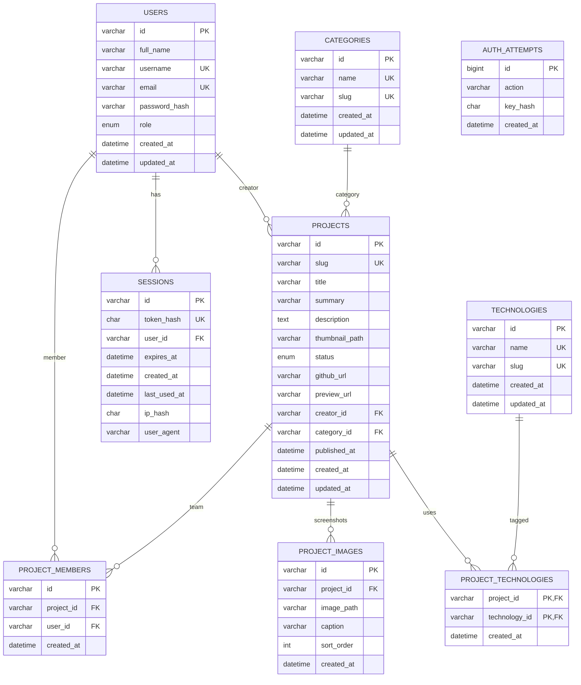

# KaryaKelas — Rancangan Database

Database: MySQL 8.x hosted (Railway MySQL). ORM: Prisma 7 dengan `@prisma/adapter-mariadb`.

## 1. ERD



`AUTH_ATTEMPTS` sengaja tidak memiliki relasi. Tabel ini operasional untuk rate limiting dan tidak muncul di UI.

## 2. Enum

```prisma
enum Role {
  ADMIN
  USER
}

enum ProjectStatus {
  DRAFT
  PUBLISHED
}
```

## 3. Definisi tabel

### `users`

| Kolom | Tipe | Aturan |
|---|---|---|
| `id` | `VARCHAR(30)` | PK, `cuid()` |
| `fullName` | `VARCHAR(80)` | Wajib |
| `username` | `VARCHAR(30)` | Wajib, unique, lowercase |
| `email` | `VARCHAR(254)` | Wajib, unique, lowercase |
| `passwordHash` | `VARCHAR(255)` | Wajib, Argon2id |
| `role` | `ENUM('ADMIN','USER')` | Default `USER` |
| `createdAt` | `DATETIME(3)` | Default now |
| `updatedAt` | `DATETIME(3)` | Auto update |

Index: unique `email`, unique `username`, index `fullName` untuk pencarian creator.

### `sessions`

| Kolom | Tipe | Aturan |
|---|---|---|
| `id` | `VARCHAR(30)` | PK, `cuid()` |
| `tokenHash` | `CHAR(64)` | Wajib, unique, SHA-256 hex |
| `userId` | `VARCHAR(30)` | FK ke `users.id` |
| `expiresAt` | `DATETIME(3)` | Wajib, absolut 7 hari |
| `createdAt` | `DATETIME(3)` | Default now |
| `lastUsedAt` | `DATETIME(3)` | Default now, diperbarui oportunistik |
| `ipHash` | `CHAR(64)` | Nullable, HMAC IP |
| `userAgent` | `VARCHAR(255)` | Nullable, dipotong |

Index: unique `tokenHash`, index `userId`, index `expiresAt`.

### `auth_attempts`

| Kolom | Tipe | Aturan |
|---|---|---|
| `id` | `BIGINT` | PK, auto increment |
| `action` | `VARCHAR(20)` | `LOGIN` / `REGISTER` |
| `keyHash` | `CHAR(64)` | HMAC-SHA256 identifier + IP + action |
| `createdAt` | `DATETIME(3)` | Default now |

Index: `(action, keyHash, createdAt)`, `createdAt` untuk cleanup.

### `categories`

| Kolom | Tipe | Aturan |
|---|---|---|
| `id` | `VARCHAR(30)` | PK, `cuid()` |
| `name` | `VARCHAR(60)` | Wajib, unique |
| `slug` | `VARCHAR(80)` | Wajib, unique |
| `createdAt` | `DATETIME(3)` | Default now |
| `updatedAt` | `DATETIME(3)` | Auto update |

### `technologies`

| Kolom | Tipe | Aturan |
|---|---|---|
| `id` | `VARCHAR(30)` | PK, `cuid()` |
| `name` | `VARCHAR(60)` | Wajib, unique |
| `slug` | `VARCHAR(80)` | Wajib, unique |
| `createdAt` | `DATETIME(3)` | Default now |
| `updatedAt` | `DATETIME(3)` | Auto update |

### `projects`

| Kolom | Tipe | Aturan |
|---|---|---|
| `id` | `VARCHAR(30)` | PK, `cuid()` |
| `slug` | `VARCHAR(160)` | Wajib, unique |
| `title` | `VARCHAR(160)` | Wajib |
| `summary` | `VARCHAR(280)` | Wajib, untuk kartu |
| `description` | `TEXT` | Wajib |
| `thumbnailPath` | `VARCHAR(2048)` | Nullable; wajib bila `PUBLISHED` (validasi server) |
| `status` | `ENUM('DRAFT','PUBLISHED')` | Default `DRAFT` |
| `githubUrl` | `VARCHAR(2048)` | Nullable, harus https + host GitHub |
| `previewUrl` | `VARCHAR(2048)` | Nullable, harus https + allowlist |
| `creatorId` | `VARCHAR(30)` | FK ke `users.id` |
| `categoryId` | `VARCHAR(30)` | FK ke `categories.id` |
| `publishedAt` | `DATETIME(3)` | Nullable; diisi saat pertama kali publish |
| `createdAt` | `DATETIME(3)` | Default now |
| `updatedAt` | `DATETIME(3)` | Auto update |

Index:
- unique `slug`
- `status`
- `categoryId`
- `creatorId`
- `title`
- `publishedAt`
- `(status, publishedAt)` untuk landing/galeri
- `(status, categoryId)`
- `(status, creatorId)`

### `project_members`

| Kolom | Tipe | Aturan |
|---|---|---|
| `id` | `VARCHAR(30)` | PK, `cuid()` |
| `projectId` | `VARCHAR(30)` | FK ke `projects.id` |
| `userId` | `VARCHAR(30)` | FK ke `users.id` |
| `createdAt` | `DATETIME(3)` | Default now |

Constraint: unique `(projectId, userId)`. Index: `userId`.

### `project_images`

| Kolom | Tipe | Aturan |
|---|---|---|
| `id` | `VARCHAR(30)` | PK, `cuid()` |
| `projectId` | `VARCHAR(30)` | FK ke `projects.id` |
| `imagePath` | `VARCHAR(2048)` | Wajib |
| `caption` | `VARCHAR(200)` | Nullable |
| `sortOrder` | `INT` | Default 0 |
| `createdAt` | `DATETIME(3)` | Default now |

Index: `(projectId, sortOrder)`. Tidak unique pada `sortOrder` agar reorder tidak memicu konflik sementara.

### `project_technologies`

| Kolom | Tipe | Aturan |
|---|---|---|
| `projectId` | `VARCHAR(30)` | PK komposit, FK ke `projects.id` |
| `technologyId` | `VARCHAR(30)` | PK komposit, FK ke `technologies.id` |
| `createdAt` | `DATETIME(3)` | Default now |

Primary key komposit: `(projectId, technologyId)`. Index tambahan: `technologyId` untuk filter teknologi.

## 4. Aturan `onDelete`

| Relasi | onDelete | Alasan |
|---|---|---|
| `projects.creatorId → users.id` | `Restrict` | Project tidak boleh kehilangan creator; user creator tidak bisa dihapus |
| `projects.categoryId → categories.id` | `Restrict` | Kategori yang masih dipakai tidak bisa dihapus |
| `project_members.projectId → projects.id` | `Cascade` | Baris anggota milik project ikut terhapus |
| `project_members.userId → users.id` | `Cascade` | Keanggotaan ikut terhapus bila user dihapus |
| `project_images.projectId → projects.id` | `Cascade` | Screenshot milik project ikut terhapus |
| `project_technologies.projectId → projects.id` | `Cascade` | Relasi teknologi milik project ikut terhapus |
| `project_technologies.technologyId → technologies.id` | `Restrict` | Teknologi yang masih dipakai tidak bisa dihapus tanpa melepas relasi |
| `sessions.userId → users.id` | `Cascade` | Session user ikut terhapus |
| `auth_attempts` | Tanpa FK | Tabel operasional rate limit |

Catatan:
- `project_members.userId` memakai `Cascade`, tetapi user yang menjadi creator dilindungi `Restrict` pada `projects.creatorId`.
- Tidak ada UI hapus user pada cakupan ini.
- Penghapusan project akan menghapus baris anggota, gambar, dan relasi teknologi. File Blob dihapus best-effort oleh action, bukan oleh database.

## 5. Index dan pencarian

Index wajib yang dipenuhi:
- `projects.slug` unique
- `projects.status`
- `projects.categoryId`
- `projects.creatorId`
- `projects.title`
- `users.fullName`
- `users.username` unique
- `project_technologies.technologyId`
- `project_members.(projectId,userId)` unique
- `project_images.(projectId,sortOrder)`

Catatan performa:
- Collation tabel dari migrasi Prisma: `utf8mb4_unicode_ci` (case-insensitive). Dengan begitu `contains` tidak memerlukan `mode: "insensitive"`. Database lokal memakai default `utf8mb4_0900_ai_ci`, tetapi collation tabel mengikuti migrasi.
- Pencarian memakai `contains`, yang menghasilkan `LIKE '%...%'`. Index B-tree pada `title`/`fullName`/`username` tidak dijamin dipakai untuk leading wildcard. Untuk katalog kelas ini masih wajar.
- Bila jumlah project membesar, opsi berikutnya: MySQL FULLTEXT pada `title`/`summary` + tabel pencarian creator, atau search service eksternal. Jangan memakai raw SQL dengan input user.

## 6. Pola query

### Galeri

```text
WHERE status = 'PUBLISHED'
  AND (title LIKE %q% OR creator.fullName LIKE %q% OR creator.username LIKE %q%)
  AND category.slug = :category
  AND EXISTS teknologi.slug = :tech
ORDER BY publishedAt DESC, id DESC
LIMIT 9 OFFSET :offset
```

Implementasi Prisma:
- `select` hanya kolom kartu.
- `creator: { select: { fullName, username } }`
- `category: { select: { name, slug } }`
- `projectTechnologies: { take: 3, select: { technology: { select: { name, slug } } } }`
- `_count: { select: { projectTechnologies: true } }` untuk badge `+N`.
- `count` dan `findMany` dalam `$transaction`.
- Parameter `q`, `category`, `tech`, `page` divalidasi Zod sebelum query.

### Detail

- `WHERE slug = :slug AND status = 'PUBLISHED'` untuk USER.
- ADMIN boleh tanpa filter status.
- `select` deskripsi, creator, member (fullName, username), gambar (imagePath, caption, sortOrder), teknologi, link.
- `projectImages` diurutkan `sortOrder asc`, `id asc`.

### Admin

- Search `q` pada title/slug/creator.
- Page size 20.
- `select` id, slug, title, status, category, creator, updatedAt.
- Form edit memilih relasi yang dibutuhkan saja.

### Mutasi

- Semua mutasi memakai `prisma.$transaction` bila menyentuh beberapa tabel, misalnya project + member + technology.
- Setelah commit, `revalidatePath` halaman terkait.
- Tangkap `P2002` (unique) dan `P2003` (foreign key) dan ubah menjadi pesan UI yang aman.
- Tidak ada raw query dari input user.

## 7. Prisma 7 dan koneksi

- `prisma7.config.ts` memuat env dan konfigurasi seed/migrasi (nama file config yang dibuat Prisma 7.10).
- `generator client` memakai output eksplisit, misalnya `src/generated/prisma`.
- Prisma Client dibuat singleton di `src/lib/db.ts` dengan `PrismaMariaDb`.
- Di development, simpan instance di `globalThis` agar HMR tidak membuat koneksi baru terus-menerus.
- Batasi connection pool adapter (awal 1–3 koneksi) dan co-locate Vercel function dengan database.
- Migrasi memakai koneksi TCP langsung. Runtime memakai `DATABASE_URL` yang sama pada Railway.
- `relationMode` default `foreignKeys`; MySQL/Railway menegakkan FK.
- Generated client tidak di-commit; dibuat oleh `prisma generate` saat install/build.

## 8. Migrasi

Lokal:

```bash
npx prisma migrate dev --name init
npx prisma db seed
```

Produksi:

```bash
npx prisma migrate deploy
```

Aturan:
- Jangan memakai `prisma db push` di produksi.
- Migrasi harus reversible secara operasional (backup sebelum migrasi destruktif).
- Perubahan schema dilakukan lewat file migrasi yang di-commit.
- Validasi "thumbnail wajib untuk PUBLISHED" dilakukan di server action, bukan CHECK constraint, agar portability provider MySQL tetap terjaga. Seed dan action publish sama-sama mematuhi aturan ini.
- Unique slug ditangani database + penanganan error aplikasi.

## 9. Seed

Seed harus idempotent dan aman dijalankan ulang.

Isi seed:
- 1 admin dari `SEED_ADMIN_NAME`, `SEED_ADMIN_USERNAME`, `SEED_ADMIN_EMAIL`, `SEED_ADMIN_PASSWORD`.
- 5 kategori contoh.
- 10 teknologi contoh.
- 4 user demo (hanya bila `SEED_DEMO_DATA=true`), password acak dan tidak ditampilkan.
- 10 project contoh: 9 `PUBLISHED`, 1 `DRAFT`.
- 2–3 screenshot per project.
- Anggota tim dan relasi teknologi.
- Thumbnail/screenshot demo memakai raster lokal `public/seed/`, bukan Vercel Blob.

Perilaku:
- Admin di-upsert berdasarkan email. Menjalankan ulang seed akan memperbarui role dan password admin dari env. Dokumentasikan agar tidak dijalankan sembarangan di produksi.
- Project demo memakai slug deterministik agar tidak duplikat.
- Bila `SEED_DEMO_DATA` tidak `true`, hanya admin yang dibuat.
- Seed gagal cepat bila env admin tidak lengkap.
- Seed produksi: jalankan sekali dengan `SEED_DEMO_DATA=false`.

## 10. Contoh schema inti

```prisma
datasource db {
  provider = "mysql"
  url      = env("DATABASE_URL")
}

generator client {
  provider = "prisma-client"
  output   = "../src/generated/prisma"
}

model Project {
  id            String        @id @default(cuid()) @db.VarChar(30)
  slug          String        @unique @db.VarChar(160)
  title         String        @db.VarChar(160)
  summary       String        @db.VarChar(280)
  description   String        @db.Text
  thumbnailPath String?       @db.VarChar(2048)
  status        ProjectStatus @default(DRAFT)
  githubUrl     String?       @db.VarChar(2048)
  previewUrl    String?       @db.VarChar(2048)
  creatorId     String        @db.VarChar(30)
  categoryId    String        @db.VarChar(30)
  publishedAt   DateTime?
  createdAt     DateTime      @default(now())
  updatedAt     DateTime      @updatedAt

  creator           User                @relation("ProjectCreator", fields: [creatorId], references: [id], onDelete: Restrict)
  category          Category            @relation(fields: [categoryId], references: [id], onDelete: Restrict)
  members           ProjectMember[]
  images            ProjectImage[]
  projectTechnologies ProjectTechnology[]

  @@index([status, publishedAt])
  @@index([status, categoryId])
  @@index([status, creatorId])
  @@index([categoryId])
  @@index([creatorId])
  @@index([title])
}
```

Schema lengkap dibuat di Fase 2. Potongan di atas hanya mengunci keputusan relasi dan index.
